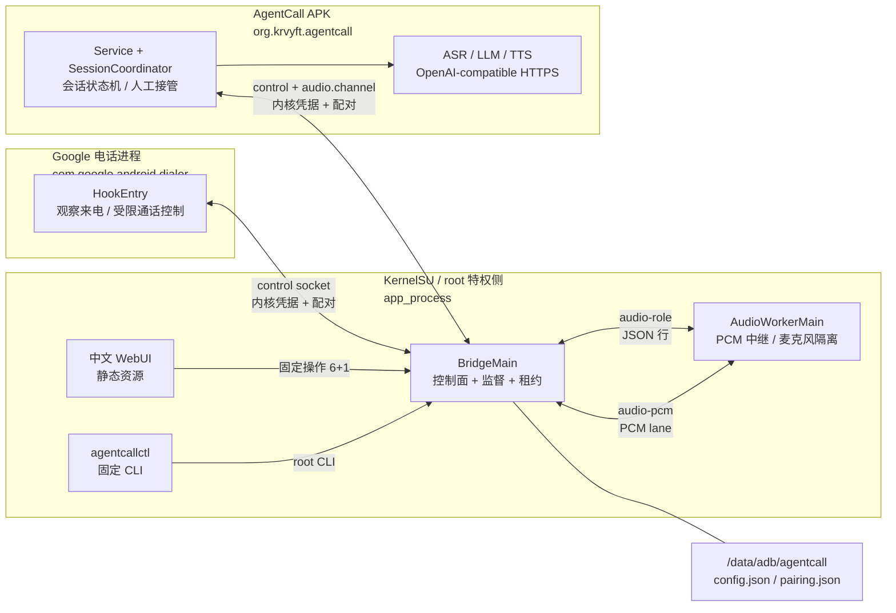

# AgentCall

**An AI call-answering bridge for Google Phone — without replacing your dialer.**

在不替换 Google 电话（`com.google.android.dialer`）的前提下，为它加上远程 AI 接听能力：
Xposed Hook 观察来电与通话状态，AgentCall APK 负责远程 ASR / LLM / TTS 语音回合，
KernelSU 模块里的 `app_process` 特权桥负责 Telecom 控制、通话音频中继、root 侧配置与中文 WebUI。


> [!IMPORTANT]
> **自动接听目前有意关闭，不是“装上就能用”。** 它需要两道闸门同时成立：
> ① 与当前设备环境绑定的校准证据（五项人工测试）；② 设备验证过的、按通话身份定位的
> 特权 Telecom 终止路径。当前默认实现 `UnverifiedCallIdentityVerifier` 保持
> `blocksAutoAnswer=true`，因此即使校准记录齐全，自动接听也不会开启。
> 本仓库的本地构建、单元测试与部分设备观测**不等于**可用性结论；完整设备验收仍未完成，
> 详见[状态矩阵](#状态矩阵)与 [docs/verification.md](docs/verification.md)。

## 它是什么，为什么这样做

- **保留 Google 电话**：不重签拨号器、不替换默认电话应用、不插入它的内部布局；
  拨号、响铃、通话 UI、记录与人工控制仍由 Google 电话负责。
- **Hook 而不是改包**：通过 Vector / LSPosed 加载传统 Xposed 模块，只作用于
  `com.google.android.dialer`，不注入 `system_server`。
- **root 只做特权动作**：KernelSU 模块用 `app_process` 运行 `BridgeMain`（控制面 + 监督）
  与独立的 `AudioWorkerMain`（PCM / 麦克风隔离）；桥接不发起任何远程 API 请求。
- **AI 在 APK 进程**：ASR、LLM、TTS 是可分别配置的 OpenAI-compatible HTTPS 端点，
  语音回合、名单规则、会话状态机与人工接管界面都在普通应用进程。
- **配置留在设备**：主副本在 root 私有目录 `/data/adb/agentcall`，中文 WebUI 只调用固定
  CLI，密钥不进入 argv、URL 或日志。

## 架构



三个信任层、两个进程边界：

| 层 | 进程 / uid | 职责 | 明确不做 |
| --- | --- | --- | --- |
| Hook | Google 电话进程，拨号器 uid | 动态发现 `InCallService`，观察通话快照，执行受限接听/挂断 | 不跑 ASR/网络/音频编解码，不读 API Key |
| 特权桥 | root `app_process`，uid 0 | 控制 socket、配对核验、监督/租约、配置 CAS、音频中继、校准 | 不发起远程 API 请求，不全局 `endCall` |
| APK | 普通应用 uid | 会话协调、远程语音回合、通知/接管 UI、诊断 | 不持有 root、不改默认拨号器角色 |

依赖方向固定为 `app -> core <- bridge`；`core` 不依赖 Android，规则、状态机、协议与鉴权都在
JVM 上可测。更深的分层、帧格式与状态机见 [docs/architecture.md](docs/architecture.md)。

## 已实现能力

| 能力 | 实现要点 |
| --- | --- |
| 三种名单模式 | `BLACKLIST` / `WHITELIST` / `COMBINED`；完整号码精确匹配，libphonenumber 按地区规范化，默认 `CN`；空黑名单不接管，空白名单在白名单/组合模式下匹配所有可识别号码 |
| 未知号码开关 | 未知/隐藏/不可解析号码由 `handleUnknownNumbers` 独立控制，默认**人工处理** |
| 通话资格 | 只处理新的入站 `RINGING`；紧急、会议、非唯一一路、未启用的 PhoneAccount 一律保留原响铃；默认 PhoneAccount 列表为空 = 不自动接管 |
| 随机会话身份 | `SessionId(processEpoch, callId)` 均为随机 UUID，绝不用电话号码；旧进程代次/别的 callId 的快照不会触发命令 |
| 单次接听 | 每个会话最多下发一次 Answer；重复 RINGING、重复回调不会重置倒计时或第二次触碰 Telecom |
| 人工交还 | 先停 AI、再串行撤销所有权、确认后才恢复音频；**不挂断**；撤销失败不会显示“交还成功” |
| 音频隔离与故障终止 | 只使用通话下行提取/上行注入，不用环境麦克风替代；音频失败保持隔离并开 10 s 人工接管窗口，心跳 5 s 失联、默认 180 s 通话上限（可配 10–600 s）、音频进程 60 s 内最多 3 次重启；只终止自己租约下的精确通话 |
| 三个独立端点 | ASR `audio/transcriptions`（multipart WAV）、LLM `chat/completions`（非流式）、TTS `audio/speech`（WAV）；各自 baseUrl / model / key，可指向不同供应商；只接受 HTTPS |
| 回合引擎上限 | VAD 静音 800 ms、单段 15 s、连接超时 10 s、生成阶段 45 s、响应 8 MiB、上下文最多 8 轮、回复 300 字、429/5xx 在截止时间内最多重试一次；播放等待不计入 45 s |
| 校准证据 | 五项人工测试 + 十个环境字段；仅 API 37；证据与环境逐字段绑定；只能由 root CLI `calibrate` 写入，APP/Hook 不能伪造 |
| 配置与 WebUI | 版本化原子写入 + revision CAS；密钥 Keep/Replace/Clear 脱敏；WebUI 六条固定 CLI 操作 + 一条模块侧 `restart`；保存走 `ksu.io` 文件或 exec+env 分块，二者都不可用时只读 |
| 可复现打包 | 确定性模块 ZIP、bridge DEX manifest、版本单一来源、`check_package.py` 检查结构/DEX/版本/签名/密钥泄漏/SHA-256 |

## 快速开始

> 以下是**未在设备上完整验收**的安装路径。自动接听在完成校准与身份终止验证前不会开启；
> 详细命令、回退与证据要求见 [docs/install.md](docs/install.md)。

1. **准备**：Xperia 1 V（目标设备 XQ-DQ72）、Android 17 / API 37、KernelSU、
   Vector 或 LSPosed、官方 Google 电话 `com.google.android.dialer`。不需要也不应该卸载它。
2. **安装模块**：KernelSU 管理器 → 模块 → 从本地安装 → 选择 `dist/agentcall-1.0.zip`，
   然后重启手机。
3. **安装 APK**：`adb install -r dist/agentcall-1.0.apk`（或文件管理器安装）。
   当前 APK 为 **debug 签名**，不同签名不能覆盖安装；分发前必须用发布密钥重签。
4. **启用作用域**：在 Vector/LSPosed 中启用 AgentCall，作用域**只勾选**
   `com.google.android.dialer`；强制停止拨号器或重启，让 Hook 生效。
5. **确认桥接**（root）：
   `su -c /data/adb/modules/agentcall/bin/agentcallctl status`。
   首次失败先看 `/data/adb/agentcall/logs/service.log` 的 `package_provider=` 行。
6. **配对**（root，首次只能由 root 发起）：
   `su -c /data/adb/modules/agentcall/bin/agentcallctl pair`。
   配对绑定 uid + 签名 SHA-256 + `versionName`；APK 或拨号器升级后需要重新配对。
7. **配置端点**：在 WebUI 的 AI 页填写 ASR/LLM/TTS 的 HTTPS baseUrl、model、key；
   密钥只经受控通道写入，页面只显示 `CONFIGURED` / `MISSING`。
8. **校准（root 操作员）**：按 [docs/install.md](docs/install.md) 第 7 节完成五项人工测试，
   用 `agentcallctl calibrate` 从 stdin 写入；校准只绑定当前环境，任一环境字段变化即失效。
9. **开启总开关**：默认关闭。只有同时满足“校准证据 + 按身份的独立终止能力”才会自动接听；
   当前第二项仍不成立，所以自动接听保持关闭。可以先用规则试算、诊断和手动接管观察行为。

## 状态矩阵

状态只按证据分级：**本地已验证**（宿主构建/测试）、**设备已观察**（只读或日志观测）、
**未验证/阻塞**（没有设备证据或产品闸门未解除）。三者不能互相替代。

### 本地已验证（代码 HEAD `647a52f`）

| 项目 | 结果 |
| --- | --- |
| JVM 单测 | `core 127 / bridge 429 / app 366`，合计 **922**，0 failures / 0 errors / 0 skipped |
| WebUI node | **149 / 149** 通过（含分块 env、payload cap、密钥卫生、stop.lock 回归） |
| Python 打包 | **59 / 59** 通过；`sh -n` 检查 4 个模块脚本 |
| 最终 Gradle 矩阵 | 225 个任务，`BUILD SUCCESSFUL`（`--rerun-tasks`） |
| Lint | `:app:lintDebug` 0 errors / 15 warnings（全部 warning） |
| R8（release） | 启用，`packageScope = setOf("**")`，mapping 约 99k 行 |
| 打包检查 | `make package-check` PASS：appId、版本 1.0 (1)、DEX manifest、签名类型、密钥泄漏、SHA-256 |

### 设备已观察（XQ-DQ72 / API 37，部分观测）

| 观测 | 证据 |
| --- | --- |
| Vector 注入成功 | Vector v2.2（legacy Xposed API 82）日志：`Loading legacy module org.krvyft.agentcall`、`Loading class ...HookEntry`、`installed 4 of 4 hook(s)` |
| 真实来电 | 拨号器日志出现一次 `state=RINGING direction=INCOMING` |
| 默认拨号器 | root shell `cmd role get-role-holders android.app.role.DIALER` / `cmd telecom get-default-dialer` 确认是 `com.google.android.dialer` |
| 桥接启动落点 | 启动日志 `package_provider=appglobals` |

这些观测**只覆盖上表四行**。当时新 ZIP/APK 尚未安装、未重启；空闲 `hookConnected=true`、
`dialerDefaultRole=true` 的 boolean 形态、校准环境字段与 chunked env 保存都仍待复测。
修复前一次 RINGING 时 `hookConnected=false`，原因是旧实现只按会话心跳；11Q 已改为空闲
`hook.presence`，但这是修复动机，不是设备验收。

### 未验证 / 阻塞

| 范围 | 状态 |
| --- | --- |
| 完整接听/音频链路 | **未验证**：没有一次自动接听或音频归档 |
| AudioRecord / AudioTrack / 播放头 / HAL / 麦克风隔离读回 | **未验证** |
| Telecom 控制、按身份定位的特权终止 | **未验证且阻塞自动接听**；当前实现明确返回 `UNSUPPORTED`，绝不全局 `endCall` |
| 锁屏 / Doze / 重启 / 通知 / FGS / 进程死亡 | **未验证** |
| KernelSU 真机 WebUI、`ksu.io` 文件通道、exec+env 分块保存 | **未验证** |
| 五项人工校准与设备环境读回 | **未验证**；设备上尚未执行校准记录 |
| D01–D12 设备验收矩阵 | 全部**未验证**，见 [docs/device-validation.md](docs/device-validation.md) |
| 发布签名 | APK 只有 debug 签名（`CN=Android Debug`），**不可分发** |
| 双卡 / VoWiFi / 蓝牙 | **未验证**；未测组合不启用 |

> **自动接听为什么现在是关闭的**：校准只解决“环境与人工测试证据”，不能替代“Hook 死亡时
> 仍能按通话身份精确终止”的能力。默认 `UnverifiedCallIdentityVerifier` 永远报告不可用，
> 因此 `EmergencyCallControl.blocksAutoAnswer() == true`。这是一个有意的 fail-closed
> 产品闸门，不是可以通过改设置绕过的开关。

## 安全与隐私

- **不抢默认拨号器角色**：APK 不请求 `ROLE_DIALER`，不伪用只授予默认拨号器的前台服务资格；
  Hook 只作用于 `com.google.android.dialer`。
- **不注入系统进程**：不修改 `system_server`、不重签 Google 电话、不改 SELinux、不自动刷框架。
- **compileOnly Xposed**：Xposed API 82 只在编译期存在，运行时由用户安装的 Vector/LSPosed 提供，
  不打包进 APK。
- **角色 + 内核凭据**：控制 socket 的对端身份来自内核凭据，不信任消息自述；CLI 必须是 uid 0；
  APP/Hook 必须是已配对、签名与版本匹配的非 root 进程。配对记录绑定 uid + 签名 SHA-256 + 版本。
- **密钥只 root 私有**：`/data/adb/agentcall` 0700，`config.json` 0600；密钥不进入 argv、URL、
  日志或错误消息；WebUI 只看到 `CONFIGURED` / `MISSING`。
- **WebUI 传输**：首选 `ksu.io` 受控文件 + stdin；没有文件接口时走固定命令 + `AGENTCALL_CFG_PAYLOAD_0..N`
  分块 env；两者都不可用则只读拒绝保存，**绝不降级到 argv/base64**。
- **debug 签名警告**：当前证书是 `CN=Android Debug`，不是发布密钥。它只用于本地安装验证，
  不构成安全边界，也不能作为分发版本。

完整威胁模型、攻击面与非目标见 [docs/security.md](docs/security.md)。

## 仓库结构

| 路径 | 内容 |
| --- | --- |
| `app/` | Xposed 入口、Hook 传输、会话协调、远程 AI 客户端、Views/通知/诊断 |
| `core/` | 共享 contracts、角色/方法鉴权、名单规则、会话 reducer、租约、校准策略 |
| `bridge/` | root 特权桥：IPC、监督、音频中继、配置 CAS、校准存储、固定 CLI |
| `module/` | KernelSU 模块：`module.prop`、`service.sh`、`customize.sh`、`uninstall.sh`、`bin/agentcallctl`、`webroot/` |
| `tools/` | `package.py`、`check_package.py` 与打包测试 |
| `docs/` | 安装、配置、验证、设备矩阵、架构、安全、排障、路线图、FAQ |

## 构建与测试

本机已验证环境：Gradle Wrapper 9.6.0、Launcher JVM 17、Daemon JVM 25、Android SDK
compileSdk 37（platform `android-37.0`，build-tools 36.0.0）、Node 26.13.0、Python 3.14.9。
不下载额外二进制；Gradle 调用按仓库约定串行化。

```sh
# 单一 JVM 矩阵（串行化，避免并发争抢 daemon）
flock /tmp/agentcall-gradle.lock ./gradlew \
  :core:testDebugUnitTest :bridge:testDebugUnitTest :app:testDebugUnitTest \
  :app:lintDebug :app:assembleRelease :bridge:packageRuntime --rerun-tasks

# 统一入口
make test            # JVM + WebUI node + Python + shell 语法
make build           # release APK + bridge 运行时容器 + dist 打包
make package-check   # 结构 / DEX / 版本 / 签名 / 密钥泄漏 / SHA-256
make lint            # :app:lintDebug
```

最终产物（`dist/` 不提交，哈希绑定代码 HEAD `647a52f` 的这次构建）：

| 文件 | 大小 | SHA-256 |
| --- | --- | --- |
| `dist/agentcall-1.0.zip` | 1,426,689 B（11 个条目） | `65902224bf5a65e8d0c7f2a045c8081e17c31832be0c634504f0254329577577` |
| `dist/agentcall-1.0.apk` | 2,274,772 B | `58f0a83c2247ed23ccea54264fbd0bc90aac3b2075d757d5c5f8cb5cc46876ca` |
| `dist/SHA256SUMS` | 168 B | 与上面两行一致 |

```sh
cd dist && sha256sum -c SHA256SUMS
```

**哈希只对这次构建成立**：APK 内嵌构建元数据，打包不是逐字节可复现；在任何更晚的提交
（包括 docs-only 提交之后）重建都会改变字节，必须重新生成 `SHA256SUMS`。重签 APK 同样会
改变摘要。ZIP 共 11 个条目，含 bridge DEX manifest，不含 `webroot/tests/`、私钥或令牌。

## 排障入口

| 症状 | 先看什么 | 入口 |
| --- | --- | --- |
| 桥接没起来 | `service.log` 的 `package_provider=` / `package_manager_unavailable` | [docs/troubleshooting.md](docs/troubleshooting.md) 第 1 节 |
| `hookConnected=false` | `logcat` 的 `hook_transport` 机器码、作用域 | [docs/troubleshooting.md](docs/troubleshooting.md) 第 3 节 |
| WebUI 保存只读 | 诊断页 `ioMode` / `envProbe`；`transport=env bytes chunks` | [docs/troubleshooting.md](docs/troubleshooting.md) 第 6 节 |
| WebUI `transport_failed` | `agentcallctl status`、控制 socket、服务是否存活 | [docs/troubleshooting.md](docs/troubleshooting.md) 第 2 节 |
| 默认拨号器 `unknown` | `cmd role` / `cmd telecom` 两条 root 命令 | [docs/troubleshooting.md](docs/troubleshooting.md) 第 4 节 |
| 升级后连不上 | `peer_version_mismatch` / `peer_uid_mismatch` | [docs/troubleshooting.md](docs/troubleshooting.md) 第 9 节 |
| `stop.lock` 超时 / 卸载残留 | `service.log` 的 `stop_lock_*`、隔离读回 | [docs/troubleshooting.md](docs/troubleshooting.md) 第 7–8 节 |

## 文档索引

| 文档 | 内容 |
| --- | --- |
| [docs/install.md](docs/install.md) | 产物、安装、配对、配置、校准、升级/回退/卸载、常见错误 |
| [docs/config-schema.md](docs/config-schema.md) | 配置磁盘格式、CAS、密钥生命周期、错误码、固定 CLI、WebUI 传输 |
| [docs/verification.md](docs/verification.md) | 最终本地矩阵、lint/R8、产物哈希、设备部分观测与未运行清单 |
| [docs/device-validation.md](docs/device-validation.md) | D01–D12 真机矩阵、翻绿规则、证据命令 |
| [docs/architecture.md](docs/architecture.md) | 进程/线程、IPC 帧、角色表、状态机、租约、音频、校准、关闭语义 |
| [docs/security.md](docs/security.md) | 威胁模型、信任边界、配对、密钥、WebUI 传输、攻击面与非目标 |
| [docs/troubleshooting.md](docs/troubleshooting.md) | 症状 → 证据 → 修复，含 adb/root 命令 |
| [docs/roadmap.md](docs/roadmap.md) | 已完成 / 未完成 / 明确不做，以及阻塞自动接听的两道闸门 |
| [docs/faq.md](docs/faq.md) | 是否替换拨号器、是否需要 root、会不会上传录音等短问答 |
| [docs/superpowers/specs/2026-11-10-agentcall-design.md](docs/superpowers/specs/2026-11-10-agentcall-design.md) | 设计规格（权威约束与边界） |

## 路线图与阻塞

- **已完成**：Hook + root 特权桥 + 独立音频工作进程 + APK 的实现、922 JVM / 149 node / 59 Python 本地矩阵、lint、R8、确定性模块 ZIP 打包、
  设备上的 Vector 注入与一次 RINGING 观测。
- **P0 阻塞**：设备校准证据（五项人工测试 + 环境读回）；按通话身份定位的特权 Telecom 终止；
  D01–D12 完整验收；发布签名。
- **P1 待验证**：音频/HAL/隔离、锁屏/重启/FGS、KernelSU WebView 与 chunked env、双卡/VoWiFi/蓝牙。
- **明确不做**：替换 Google 电话、处理微信等应用通话、完整双工打断、多通电话同时由 AI 处理、
  注入 `system_server`、改 SELinux。

详情与验收路径见 [docs/roadmap.md](docs/roadmap.md)。

## 参与贡献

- Bug / 功能建议请开 issue；提交 PR 前先说明设备、ROM、KernelSU/Vector 版本与复现步骤。
- **不要提交任何密钥、令牌、keystore、真实电话号码、联系人、未脱敏日志或通话录音。**
- 代码改动必须带测试；设备结论必须附带证据路径/哈希，不能把 JVM 测试写成真机通过。
- 文档中的“未验证”是刻意的状态，不要为了好看改成“已支持”。

## 免责声明

- 需要 root（KernelSU）与 Xposed 框架，**有变砖、掉数据、系统不稳定和保修失效的风险**；
  请自行备份并确认设备可恢复。
- 行为高度依赖 ROM、厂商音频 HAL、Google 电话版本与框架实现；不同设备/版本可能不支持。
- **不要用于紧急呼叫**。紧急/会议/多路通话会被明确排除，但任何自动化都不能替代人工判断。
- 语音与文本会发送给你配置的第三方供应商，可能产生费用；请自行评估隐私与合规。
- 当前产物是开发构建、debug 签名，**不构成可分发或生产可用的电话助理**。

## 致谢

- [KernelSU](https://github.com/tiann/KernelSU)：模块与 root 运行环境。
- [Vector](https://github.com/JingMatrix/Vector) / [LSPosed](https://github.com/LSPosed/LSPosed)：Xposed 兼容层。
- [libphonenumber](https://github.com/google/libphonenumber)：号码规范化。
- [OkHttp](https://square.github.io/okhttp/)：HTTPS 传输。

## 许可证

本项目以 **GNU General Public License v2.0（GPL-2.0-only）** 发布，完整文本见 [LICENSE](LICENSE)。

- 你可以自由使用、修改与再分发，但分发衍生作品时必须同样以 GPL-2.0 开源并提供对应源码；
  且不提供任何担保（详见许可证第 11、12 条）。
- 仓库中的 `docs/superpowers/` 规格与计划文档、设备证据与商标名称分别归其权利人所有；
  Google 电话、KernelSU、Vector/LSPosed 等第三方组件遵循各自许可证。
