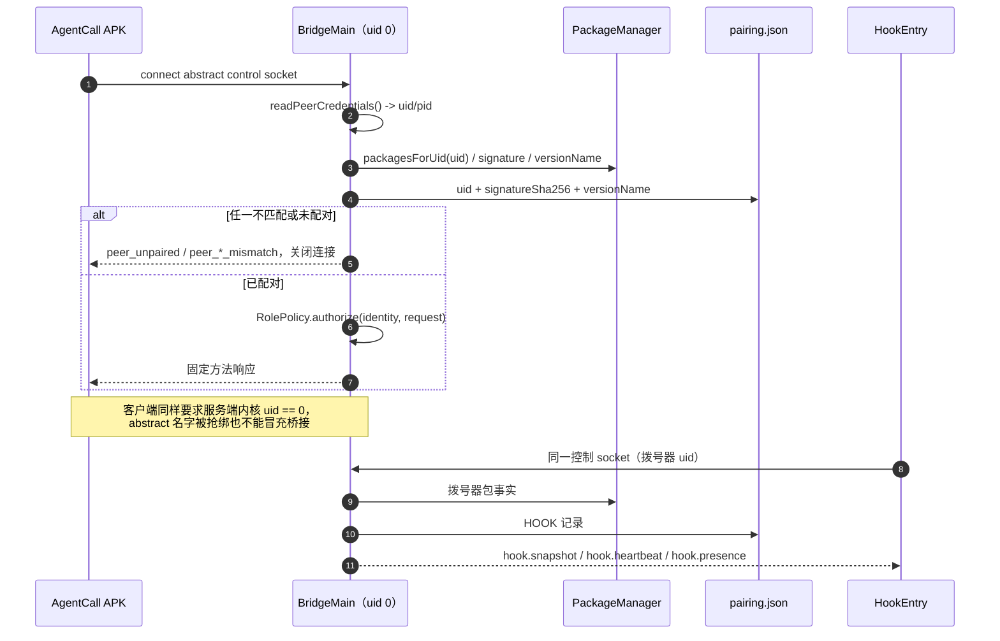
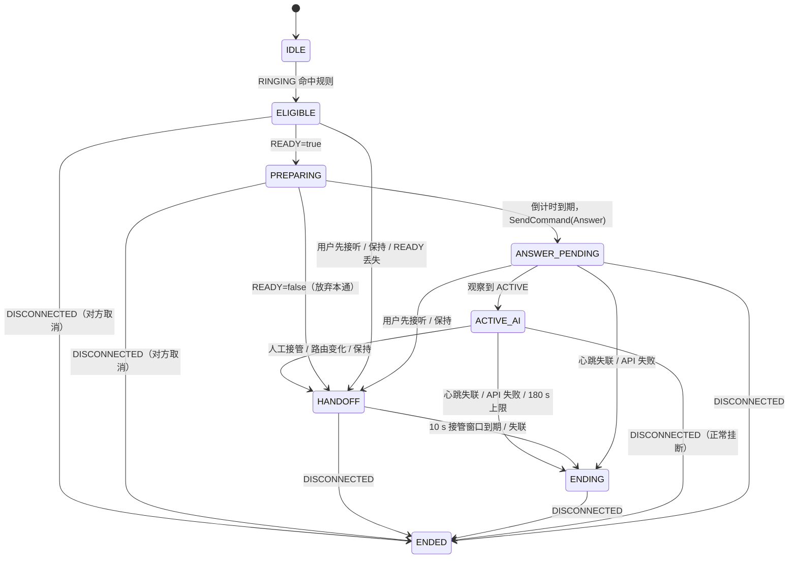
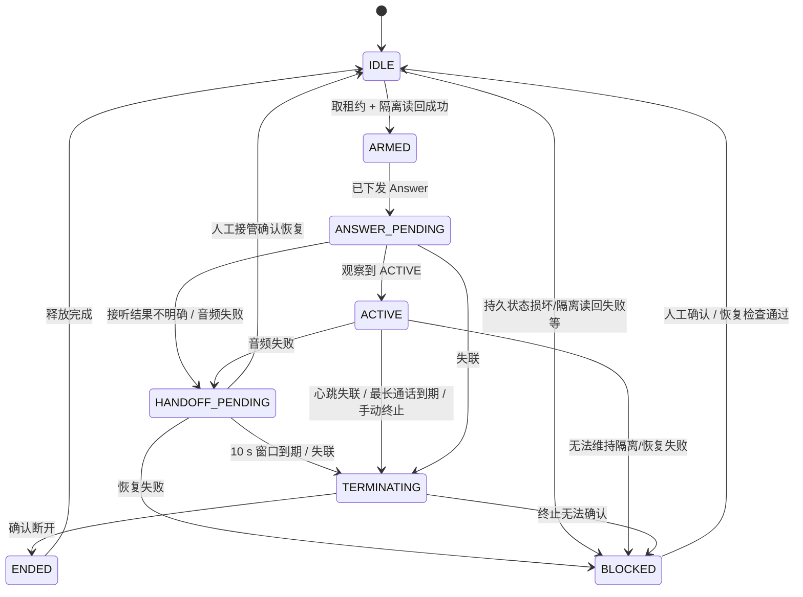
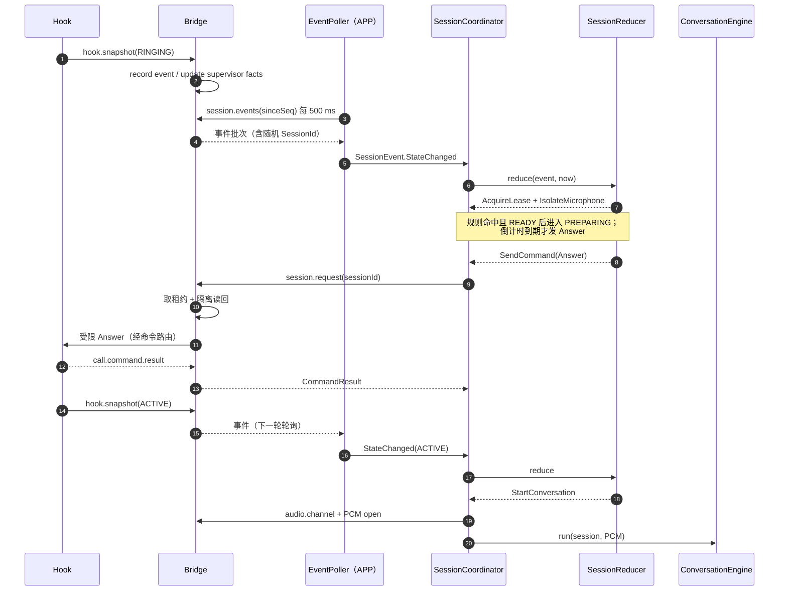

# AgentCall 架构深潜

本文描述 **代码 HEAD `647a52f`** 的进程、IPC、状态机与所有权设计，引用仓库内的真实实现文件。
所有“设备已验证”的表述只用于 [docs/verification.md](verification.md) 5.4 列出的具体观测；
本文其余内容都是代码/本地测试层面的事实，**不表示已在真机跑通**。

## 1. 进程与线程模型

AgentCall 有四个执行角色、三个 uid 边界：

| 角色 | 宿主 | 线程/并发 | 职责 |
| --- | --- | --- | --- |
| Hook | Google 电话进程（拨号器 uid） | `InCallService` 回调在主线程；传输每条请求一个 abstract socket；心跳/presence 每 2 s | 动态发现 `InCallService` 子类，观察 `Call` 快照，执行受限 Answer/Hangup |
| Bridge（监督） | root `app_process`（uid 0） | main 等待；控制 accept 线程；控制 worker 2 / 队列 16；命令 lane 2 / 队列 8 / 4 个槽；PCM 2 条连接各占一个线程；监督轮询 500 ms | 控制面、配对核验、监督/租约、配置 CAS、音频中继、校准、优雅关闭 |
| Audio worker | 独立 root `app_process`（uid 0） | main + 角色通道 + PCM 服务（最多 2 条） | 持有 `AudioRecord`/`AudioTrack`、PCM 重采样、麦克风隔离读回 |
| APK | 普通应用进程 | 一个串行 consumer + 1 s ticker + 每通电话可取消子 Job + 500 ms 事件轮询 | 会话 reducer、远程 ASR/LLM/TTS、通知/接管 UI、诊断 |

关键点：

- **APK 不执行隔离**：`SessionEffect.IsolateMicrophone` 在 APK 侧是 no-op；真正的麦克风隔离由
  bridge 在 `session.request` 内通过 audio worker 完成并读回。
- **bridge 不发远程请求**：ASR/LLM/TTS 只在 APK 进程；bridge 只处理本地 socket 与系统 API。
- **音频工作进程独立**：bridge 不持有任何麦克风/音频句柄，只通过 root 私有的角色通道与
  PCM 通道转发；音频进程崩溃由监督端按预算重启，而不是让 bridge 自己重建音频流。

实现入口：`BridgeMain` / `AudioWorkerMain` / `HookEntry` / `AgentCallService`。

## 2. 连接建立与信任



- 服务端只用 `LocalSocket.getPeerCredentials()` 的 uid/pid 作为身份起点；请求 JSON 里的
  uid、包名、角色、签名**不参与判定**。
- uid 0 直接是 `CLI_ROOT`；非 root 必须由 PackageManager 解析出包名，并与配对记录的
  uid + 签名 SHA-256 + `versionName` 全部匹配，才成为 `APP` 或 `HOOK`。
- 客户端侧（`BridgeClient` / `HookTransport`）连接后先读服务端内核 uid，必须是 0 才写请求；
  否则报 `server_untrusted` / 不发送。abstract socket 名可被抢绑，但抢绑者无法通过 uid 检查。
- 配对只能由 root CLI 发起；APK/Hook 只能读取/使用配对结果，不能写入或自带签名。

## 3. 本地 IPC

### 3.1 控制通道（control）

Socket：`org.krvyft.agentcall.control`（abstract，root 桥接 bind）。
帧格式（[`RpcCodec.kt`](../core/src/main/java/org/krvyft/agentcall/core/protocol/RpcCodec.kt)）：

```text
+----------------+-------------------------------------------+
| 4 B 大端长度   | UTF-8 JSON 正文（长度 <= 64 KiB）          |
+----------------+-------------------------------------------+
```

请求 JSON：`{"id","method","version","sessionId"?,"payload"}`；响应 JSON：
`{"id","version","payload","error"?}`，`payload` 与 `error` 互斥。协议版本固定为 1。
长度在读取正文前校验：非正、超 64 KiB、截断都直接失败，不按声明长度预分配内存。

| 资源 | 上限 |
| --- | --- |
| 控制连接 | 8 |
| 控制排队 | 16 |
| 控制 worker | 2 |
| 命令 lane | 2 worker / 队列 8 / 同时 4 条长等待请求 |
| 单帧正文 | 64 KiB |
| 读超时 | 10 s（服务端）；APP 普通方法 2 s、会话方法 8 s，最长 15 s |
| 命令等待 | bridge 内等 HOOK 真实结果，最长 4 s |

**为什么分 lane**：`session.request` / `session.command` 会同步等待 HOOK 的 Answer/Hangup
结果，最长 4 s。如果它们占满 2 个控制 worker，HOOK 心跳（取走排队命令的唯一通道）会排在
后面，命令必然超时。因此这两类方法在读完帧后移交专用命令 lane；控制 lane 始终留给
HOOK 心跳、诊断、关闭。PCM 连接也绝不与控制请求共用 worker。

### 3.2 APP 音频通道（PCM lane）

Socket：`org.krvyft.agentcall.pcm`（abstract，bridge bind；APP 在 `audio.channel` 绑定后连接）。
帧格式（[`PcmLaneCodec.kt`](../bridge/src/main/java/org/krvyft/agentcall/bridge/audio/PcmLaneCodec.kt)）：

```text
+----------------+----------+-----------------------------+
| 4 B 大端长度   | 1 B 类型 | 正文（长度包含类型字节）      |
+----------------+----------+-----------------------------+
```

| 类型 | 值 | 正文 |
| --- | --- | --- |
| `CONTROL` | `0x01` | JSON：`open` / `open_ok` / `stop` / `error` / `closed` |
| `DOWNLINK` | `0x02` | PCM16LE 单声道原始字节（bridge → APP） |
| `UPLINK` | `0x03` | 4 B 大端序号 + PCM16LE 单声道（APP → bridge → worker） |
| `UPLINK_ACK` | `0x04` | JSON `{seq, ok, code}`，只在播放结束后回 |

- 单帧总长 `<= 32 KiB`；下行 PCM 单帧 `<= 32762 B`；上行 PCM 单帧 `<= 32758 B`
  （4 B 序号 + 1 B 类型 + 4 B 长度都要算进去）。奇数长度、空帧、未知类型、截断都 fail closed。
- 首帧是 JSON `open`：`{sessionId:{processEpoch,callId}, format:{sampleRate,channels,encoding}}`；
  只接受 PCM16、单声道、8 kHz–192 kHz。之后帧里**没有会话字段**，一条连接只属于一个会话，
  结构上不可能把 A 的音频送进 B。
- bridge 先通过控制面 `audio.channel` 为 `SessionId` 建立绑定；只有监督端当前拥有该会话、
  且 PCM 连接的内核 uid 与发起 `audio.channel` 的 APP 一致时才接通。每次转发都重新核对
  归属，归属消失立即结束下行/拒绝上行。
- 上限：4 个绑定、16 帧上行在途、接入期限 10 s、工作进程 2 条 PCM 连接；饱和以机器码失败，
  不阻塞控制面。

### 3.3 bridge ↔ audio worker

两条 root 私有 abstract socket，职责不同：

| 通道 | 名字 | 协议 | 用途 |
| --- | --- | --- | --- |
| 生命周期 | `org.krvyft.agentcall.audio-role` | 一行 JSON，`<= 4096` 字符 | `open` / `isolate` / `restore` / `verifyIsolation` / `stop` / `status` |
| PCM | `org.krvyft.agentcall.audio-pcm` | 与 APP PCM lane 相同的 4 B 长度 + 类型帧 | 下行 PCM / 上行 PCM + 播放 ack |

两条都只信任 uid 0 的对端。PCM **不走**生命周期通道；生命周期通道也绝不携带 PCM、密钥或号码。
角色通道是短请求一应答，混入长音频流会占住隔离/停止请求。

## 4. 角色 / 方法表

唯一权威：[`RolePolicy.kt`](../core/src/main/java/org/krvyft/agentcall/core/protocol/RolePolicy.kt)。
未知方法一律拒绝；没有通配符、没有“管理员可做任何事”。

| 角色 | 允许的方法 |
| --- | --- |
| `APP` | `session.request`、`session.heartbeat`、`session.command`、`session.events`、`status`、`diagnose`、`config.read`、`config.secret.read`、`audio.channel`、`handover`、`calibration.read` |
| `HOOK` | `hook.snapshot`、`hook.heartbeat`、`hook.presence`、`call.command.result` |
| `CLI_ROOT` | `status`、`config.read`、`config.write`、`pair`、`diagnose`、`shutdown`、`calibration.read`、`calibration.record` |

补充约束：

- `CLI_ROOT` 必须是 uid 0；`APP`/`HOOK` 必须是非 root、已配对、包名/签名/版本匹配。
- 会话方法（`session.request`、`session.heartbeat`、`session.command`、`audio.channel`、
  `handover`、`hook.snapshot`、`hook.heartbeat`、`call.command.result`）必须携带 `SessionId`。
- `session.events` **刻意不要求** SessionId：APP 正是要靠它发现新通话的随机会话 ID。
- `hook.presence` 也不要求 SessionId：它是“Hook 进程还在”的空闲存在性，不是会话信号。
- 密钥读取只对 APP 开放；HOOK 与 CLI 都拿不到原值；`calibration.record` 只属于 CLI_ROOT。

## 5. 会话状态机（APK / core reducer）

实现：[`SessionReducer.kt`](../core/src/main/java/org/krvyft/agentcall/core/session/SessionReducer.kt)。
纯 Kotlin 单写者，不读系统时钟，不接触 Android；输入事件 + `nowMs`，输出有序副作用。



| 状态 | 含义 | 进入时的关键副作用 |
| --- | --- | --- |
| `IDLE` | 无会话 | 总开关关闭会置停用闩锁；之后的 RINGING 不再接管 |
| `ELIGIBLE` | 规则命中，等 READY | 无租约/隔离；READY 丢失或用户先接听即交还 |
| `PREPARING` | 接听准备/倒计时窗口 | `AcquireLease` + `IsolateMicrophone`；倒计时基准是进入时刻 |
| `ANSWER_PENDING` | Answer 已下发，等 ACTIVE | 只发一次；观察到 ACTIVE 才打开音频 |
| `ACTIVE_AI` | AI 对话中 | `StartConversation`；最长时长从第一次 ACTIVE 起算 |
| `HANDOFF` | 已交还/等待人工 | 停音频、撤销租约、恢复麦克风；绝不挂断 |
| `ENDING` | 已发出故障终止 | 停音频 → 挂断 → 撤销租约；保持隔离直到 DISCONNECTED |
| `ENDED` | 终端 | 迟到的快照/命令不再产生效果 |

关键不变量：

- **READY 丢失是永久放弃本通**：`ELIGIBLE`/`PREPARING` 内 `ReadyChanged(false)` 会交还并停在
  `HANDOFF`；之后 READY 恢复也不会重新倒计时或接听。
- **用户先接听**：没有由本会话发出 Answer 却观察到 ACTIVE，按保守交还处理，不发任何命令。
- **心跳失联优先**：`Tick` 先检查 5 s 心跳超时，再检查 10 s 音频接管窗口，最后才是 180 s 上限。
- **终止只针对仍归 AI 的通话**：`terminateOwnedCall` 先停音频、挂断、撤销租约；已交还
  （`HANDOFF`）或租约已撤销的会话不会被挂断。
- **总开关关闭立即生效**：IDLE 置闩锁；ELIGIBLE/PREPARING 交还；ANSWER_PENDING/ACTIVE_AI 终止；
  HANDOFF 中仍持有通话则立即终止，不等窗口到期。

## 6. 监督端阶段（bridge）

监督端不是 APK 状态机的复制品，它只描述**特权侧所有权与终止进度**：



实现：[`Supervisor.kt`](../bridge/src/main/java/org/krvyft/agentcall/bridge/supervision/Supervisor.kt)。
阶段为 `IDLE / ARMED / ANSWER_PENDING / ACTIVE / HANDOFF_PENDING / TERMINATING / ENDED / BLOCKED`。
持久状态 `supervisor-state.json` schema 3 记录 phase、ownedSession、microphoneIsolated、
blockedReason、lastFault、bootId、ownedCallMayBeLive、shutdownCode；损坏/更高 schema 一律
fail closed，不把旧状态当干净启动。

监督端强制顺序：

1. 接听前必须同时满足校准授权与 `!EmergencyCallControl.blocksAutoAnswer()`；
2. 取租约 → 隔离麦克风并**读回** → 才发 Answer；
3. 音频失败：停音频、保持隔离、开 10 s 人工接管窗口；到期才终止；
4. 撤销租约后绝不下发挂断（不能杀用户已接管的电话）；
5. `BLOCKED`/`TERMINATING` 之后迟到的 ACTIVE 一律拒绝，绝不覆盖阻塞；
6. 断开确认前绝不恢复麦克风；隔离状态每轮轮询/打开前都重新读回系统事实。

## 7. 租约与所有权

实现：[`LeaseRegistry.kt`](../core/src/main/java/org/krvyft/agentcall/core/session/LeaseRegistry.kt)。

- 每通电话最多一个有效租约；`acquire` 对同一 SessionId 只成功一次。
- `revoke` 是终态：撤销后所有已发出的 `Lease` 句柄立即失效，命令返回 null，不能补发给新通话。
- 两套租约、两个闸门：
  - **APK 本地租约**：`SessionCoordinator` 的命令入口检查，人工接管后本地也不发挂断；
  - **bridge 监督租约**：真正授权 HOOK/Telecom 动作；跨进程串行化，撤销/恢复顺序由它保证。
- 命令必须绑定精确 `SessionId`：`RolePolicy` 拒绝无会话的会话方法；快照与交还事实必须
  带同一 SessionId；旧进程代次/别的 callId 的快照与 handback 被忽略。
- 不存在全局 `endCall`：默认 `ReflectiveTelecomTermination` 永远返回 `UNSUPPORTED`；
  只有未来设备验证过的“按本次通话身份定位”的 API 才允许替换。
- 交还顺序固定：停 AI 会话 → 等在途 `session.request` 有界结束 → 串行撤销所有权 →
  确认后才恢复本地音频/广播交还。撤销失败不恢复、不显示成功。
- 竞争处理：bridge 对同一会话的 Answer/Hangup 做仲裁，返回 `answer_in_flight` /
  `command_in_flight` / `command_lane_busy`；APP 不会把这些当成成功。`answer_in_flight`
  只表示“未确认，可能已被抢占”，**不代表撤回**；失败一律按未确认处理。

## 8. reducer / coordinator 的分工

`core` 的 reducer 只做**决策**；`app` 的 `SessionCoordinator` 是唯一串行消费者，负责**执行**：



- **单写者**：reducer 只在 coordinator 的 consumer 协程里被调用；UI/网络/系统回调只投递事件，
  不直接改状态。
- **有序副作用**：reducer 返回的列表必须按序执行；撤销租约晚于需要租约的挂断命令。
- **每通电话一个 generation**：命令结果按 `(SessionId, generation)` 投递；旧 generation 的结果
  只记诊断，不打开音频、不启动会话、不下发命令。
- **有界队列**：事件队列 32；命令结果等待 6 s；单槽挂断队列；没有 `GlobalScope`。
- **隔离归 bridge**：APK 的 `IsolateMicrophone` 是 no-op，避免两个进程各自改系统静音。

## 9. 音频采集、注入与隔离

音频实现：[`FrameworkAudioBridge.kt`](../bridge/src/main/java/org/krvyft/agentcall/bridge/audio/FrameworkAudioBridge.kt)、
[`AudioWorker.kt`](../bridge/src/main/java/org/krvyft/agentcall/bridge/audio/AudioWorker.kt)、
[`AudioPcmRelay.kt`](../bridge/src/main/java/org/krvyft/agentcall/bridge/audio/AudioPcmRelay.kt)。

- 只探测 AOSP 受限方法 `isPstnCallAudioInterceptable`、
  `getCallDownlinkExtractionAudioRecord`、`getCallUplinkInjectionAudioTrack`。
  **没有环境麦克风方法**：适配层无法把 `AudioRecord(MIC)` 冒充通话下行。
- 内部格式 PCM16、单声道；采样率由握手声明，适配层用 `Resampler` 转换。下行提取 → bridge →
  APP 的 ASR；TTS 上行 → bridge → worker → `AudioTrack`。
- `writeUplink` 只有播放头确认“已播放”后才返回/回 ack；APP 的 45 s 生成预算**不包含**播放，
  播放使用名义时长 + 15 s 宽限且可取消。
- 麦克风隔离走 `AudioManager.isMicrophoneMute`（需要 `MODIFY_AUDIO_SETTINGS`），设置后
  立即读回；读不到/读回失败按未隔离处理。**系统静音是否同时压掉 TTS 必须在目标 ROM 实测**，
  不能假设；这也是 D08 的核心判据。
- 音频失败分类：下行读失败、上行写失败、播放头停滞、工作进程不可达等 → 停 AI、保持隔离、
  10 s 人工接管窗口；到期仍无人接管则终止租约内的精确通话，确认断开后才恢复。
- 工作进程重启预算在监督端：60 s 窗口最多 3 次；音频进程重启不清零预算；耗尽即故障终止。
- 崩溃/SIGKILL 不走优雅关闭路径，可能留下麦克风隔离；恢复依赖重启与人工确认，见第 12 节。

## 10. 校准环境绑定

实现：[`CalibrationPolicy.kt`](../core/src/main/java/org/krvyft/agentcall/core/policy/CalibrationPolicy.kt)、
[`CalibrationStore.kt`](../bridge/src/main/java/org/krvyft/agentcall/bridge/config/CalibrationStore.kt)。

自动接听唯一判定入口是 `CalibrationPolicy.canAutoAnswer(environment, evidence)`，要求：

1. `apiLevel == 37`（策略常量，不是“设备 API 等级”）；
2. 环境十个字段完整，没有空值/UNKNOWN；
3. 证据的环境与当前环境**逐字段相等**；
4. `calibratedAtMs > 0`；
5. 五项人工测试全部为 true：`downlinkRecognized`、`peerHeardSpeech`、
   `microphoneIsolated`、`manualRestoreVerified`、`processFailureVerified`。

| 环境字段 | 来源 |
| --- | --- |
| `apiLevel`、`romFingerprint`、`kernelVersion`、`dialerPackageVersion`、`bridgeVersion`、`audioPolicyDigest` | bridge 观测 |
| `frameworkVersion` | root SystemProperties → `zygisk_*`/`lsposed`/`vector` 的 `module.prop` → XposedBridge；观测不到才由 root 背书 |
| `simCarrier` | TelephonyManager SIM 运营商名 → telephony 属性；观测不到才由 root 背书 |
| `transport`、`route` | **从不观测**，始终 UNKNOWN，只能由 root 在 `calibrate` 时背书 |

观察到的已知值永远优先于背书；APP/HOOK 不能写校准证据。写入通道是 root CLI
`agentcallctl calibrate`（JSON 只从 stdin 进入，argv 负载直接拒绝）。
当前**没有在设备上执行过五项人工测试**，所以 `verified=false`、自动接听保持关闭。

## 11. 配置 CAS 与密钥生命周期

实现：[`ConfigStore.kt`](../bridge/src/main/java/org/krvyft/agentcall/bridge/config/ConfigStore.kt)、
[`ConfigValidator.kt`](../core/src/main/java/org/krvyft/agentcall/core/rules/ConfigValidator.kt)。

- 主副本 `/data/adb/agentcall/config.json`（0600，目录 0700），schema 1，单 JSON 对象。
- 写入：同目录临时文件 → fsync → rename 原子替换；revision 与内容一起落盘。
- CAS：客户端提交 `expectedRevision`；服务端比较磁盘 revision，相等才应用 patch 并
  `revision+1`；不相等返回 `config_conflict`，**不写任何字节**。
- 补丁原子校验：任一字段非法整包拒绝（`config_invalid`），不会部分生效；未知字段/错误类型整体拒绝。
- 密钥 `Keep / Replace / Clear`：
  - `keep` 原值不动；空表单不会清除；
  - `replace` 写入非空新值，状态变 `CONFIGURED`；
  - `clear` 删除，状态变 `MISSING`。
- 读视图只返回 `CONFIGURED` / `MISSING`，没有原值、长度或前缀；日志也不记录。
- 密钥以明文保存在 root 私有文件，依赖 0700/0600 与 root 隔离，不做加密；同设备其他 root
  进程可以读取。这是明确的威胁模型边界，不是缺陷隐瞒。

## 12. 事件流与 Hook 存在性

- `session.events` 是 APP 发现新会话的唯一入口：HOOK 的随机 SessionId 不能预知。
- 进程内环形缓冲 256 条，满则丢最旧并累计 `dropped`；一次轮询最多 64 条；seq 从 1 单调递增。
- 游标为 0 从头；陈旧游标返回仍可用部分；游标大于本进程最大 seq 返回 `cursor_ahead`
  （进程重启/游标错乱），APP 必须重置基线，不能把 `cursor_ahead` 当成“暂时没有事件”。
- 事件字段固定：`seq/sessionId/epoch/state/presentation/direction/phoneAccount/isEmergency/
  isConference/activeCallCount/number/source/handbackReason/outcome`；缺失值就是 null，
  不补 false/0。
- 只记录**真实事实**：HOOK 快照、监督端已执行的交还/断开结果；没有“设置状态”接口。
- `hook.presence`：HOOK 每 2 s 发一条无会话、空负载的固定方法；bridge 按角色记录 5000 ms
  窗口，`status.hookConnected` 由此派生。它不改变所有权/监督阶段，也不要求有活动通话。
- HOOK 传输失败只打限流机器码 `hook_transport connect_failed|server_untrusted|protocol_violation
  failures=<n>`（约 5 s 一条），不含负载、会话号或号码。

## 13. 关闭与隔离语义

实现：`Supervisor.shutdown`（[`Supervisor.kt`](../bridge/src/main/java/org/krvyft/agentcall/bridge/supervision/Supervisor.kt)）
与 `module/service.sh` / `module/uninstall.sh`。

- 有拥有的会话：先下发终止/交还，5 s 期限**只约束等待“已断开/已不归 AI”的事实**
  （`awaitConfirmedDisconnect`）；终止命令本身先发，其等待另有预算。
- 确认后，单一 6 s 预算内恢复麦克风并读回；只有读回为“未隔离”才 `clean=true`。
- 期限内无法确认断开：保持隔离、保留粘性所有权标记，返回
  `shutdown_call_unresolved`（`clean=false`）。
- 恢复失败：进入 `BLOCKED`，返回 `shutdown_microphone_restore_failed`。
- 没有拥有的会话但观测到隔离：也尝试恢复；仍隔离返回 `shutdown_microphone_still_isolated`。
- `service.sh` 在桥接退出后读 `supervisor-state.json`（schema ≥ 3）：`shutdownCode` 非 null 或
  `microphoneIsolated=true` 时打印 `! microphone_still_isolated` / `! shutdown_unresolved` 与
  `bridge_stop_unclean`，绝不打印 `bridge_exit_clean`。
- 停止顺序：先取 `stop.lock` → fixed CLI `shutdown` → 等桥接退出 → 再停音频工作进程 →
  最后有界 TERM→KILL。顺序颠倒会让恢复请求不可达，麦克风可能保持全局静音。
- 桥接已退出后的清理只做一次非阻塞 `flock -n`（`stop_lock_busy` / `stop_lock_unavailable`）；
  每个 `app_process` 启动都 `9>&-`，锁 fd 不继承，不再等满 40 s。
- 模块卸载/停用会先尝试优雅关闭；但**进程退出不等于通话已结束/麦克风已恢复**，脚本不会谎称
  已交还。重启设备会重新初始化系统音频状态，但不能证明通话已结束；下一次启动仍按粘性标记
  保持 `BLOCKED`，直到人工确认。

## 14. 源码索引

| 关注点 | 文件 |
| --- | --- |
| 协议帧/JSON | [core/protocol/RpcCodec.kt](../core/src/main/java/org/krvyft/agentcall/core/protocol/RpcCodec.kt) |
| 角色/方法表 | [core/protocol/RolePolicy.kt](../core/src/main/java/org/krvyft/agentcall/core/protocol/RolePolicy.kt) |
| 会话 reducer | [core/session/SessionReducer.kt](../core/src/main/java/org/krvyft/agentcall/core/session/SessionReducer.kt) |
| 租约 | [core/session/LeaseRegistry.kt](../core/src/main/java/org/krvyft/agentcall/core/session/LeaseRegistry.kt) |
| 规则 | [core/rules/RuleMatcher.kt](../core/src/main/java/org/krvyft/agentcall/core/rules/RuleMatcher.kt) |
| 校准策略 | [core/policy/CalibrationPolicy.kt](../core/src/main/java/org/krvyft/agentcall/core/policy/CalibrationPolicy.kt) |
| 控制 socket / lane | [bridge/ipc/ControlServer.kt](../bridge/src/main/java/org/krvyft/agentcall/bridge/ipc/ControlServer.kt)、[bridge/ipc/ConnectionLanes.kt](../bridge/src/main/java/org/krvyft/agentcall/bridge/ipc/ConnectionLanes.kt) |
| 身份核验 | [bridge/ipc/PeerVerifier.kt](../bridge/src/main/java/org/krvyft/agentcall/bridge/ipc/PeerVerifier.kt) |
| 监督端 | [bridge/supervision/Supervisor.kt](../bridge/src/main/java/org/krvyft/agentcall/bridge/supervision/Supervisor.kt) |
| 事件流 | [bridge/supervision/SessionEventBus.kt](../bridge/src/main/java/org/krvyft/agentcall/bridge/supervision/SessionEventBus.kt) |
| 音频中继 | [bridge/audio/AudioPcmRelay.kt](../bridge/src/main/java/org/krvyft/agentcall/bridge/audio/AudioPcmRelay.kt)、[bridge/audio/PcmLaneCodec.kt](../bridge/src/main/java/org/krvyft/agentcall/bridge/audio/PcmLaneCodec.kt) |
| 配置 CAS | [bridge/config/ConfigStore.kt](../bridge/src/main/java/org/krvyft/agentcall/bridge/config/ConfigStore.kt) |
| APK 协调器 | [app/service/SessionCoordinator.kt](../app/src/main/java/org/krvyft/agentcall/service/SessionCoordinator.kt) |
| APK 桥客户端 | [app/ipc/BridgeClient.kt](../app/src/main/java/org/krvyft/agentcall/ipc/BridgeClient.kt) |
| Hook 注册表 | [app/hook/CallRegistry.kt](../app/src/main/java/org/krvyft/agentcall/hook/CallRegistry.kt) |

## 15. 未验证边界

以下只有 JVM/宿主测试或静态代码证据，**没有设备证据**：

- 真实 `app_process` 下的 binder/shell PackageManager 分支（设备只观测到 `package_provider=appglobals`）；
- `AudioRecord`/`AudioTrack`、受限方法可见性、HAL、重采样实际音质、播放头行为；
- 麦克风隔离（`isMicrophoneMute`）是否真的让对端听不到环境声，以及是否同时压掉 TTS；
- Telecom 精确终止：默认实现明确 `UNSUPPORTED`，没有设备验证过的身份来源；
- 锁屏/Doze/重启/FGS/通知/进程死亡；
- KernelSU 真机 WebView、`ksu.io` 文件通道与 exec+env 分块保存；
- 双卡/VoWiFi/蓝牙路由；
- D01–D12 的任何整行验收。

设备观测只覆盖 [docs/verification.md](verification.md) 5.4 的四项：Vector 注入 4/4 Hook、
一次真实 RINGING、默认拨号器确认、`package_provider=appglobals`。
