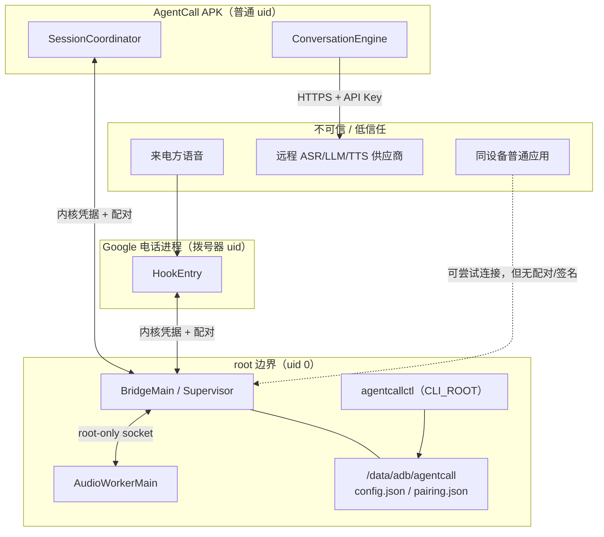

# 安全模型与信任边界

本文说明 AgentCall 保护什么、信任谁、明确不防什么。它是**设计/代码层面**的威胁模型，
不是第三方安全审计；设备侧只有 [docs/verification.md](verification.md) 5.4 列出的有限观测，
不能据此宣称“已安全验证”。

## 1. 资产与对手

| 资产 | 位置 | 泄露/滥用的后果 |
| --- | --- | --- |
| ASR/LLM/TTS API Key | root 私有 `config.json`，运行时读入 APK | 被盗刷、账单损失、供应商账户被滥用 |
| 通话控制能力 | bridge 租约 + Hook/Telecom | 误接/误挂电话，接听本不应接的来电 |
| 麦克风隔离状态 | audio worker + 系统 `AudioManager` | 对端听到本机环境声；或系统被静音影响其他应用 |
| 名单/规则/配置 | root 私有 `config.json` | 隐私（号码）与行为被篡改 |
| 配对记录 | root 私有 `pairing.json` | 未授权 APK/Hook 连接桥接 |
| 会话事件 | bridge 内存环 + APP | 号码/通话状态泄露给同设备其他应用 |

对手按能力分层：

1. **普通应用（无 root）**：能连 abstract socket、能读自己的 `/proc`、能发网络请求；
2. **同设备已授权 root 进程/模块**：能读 `/data/adb`、ptrace、改系统设置；
3. **恶意/被攻破的远程供应商**：接收音频/文本，可能记录、转售或滥用；
4. **来电方**：可说话、可社会工程，但不能直接执行设备命令；
5. **物理接触/解锁后的攻击者**：可装应用、读存储、改系统。

## 2. 信任边界

边界规则：

- **内核凭据是唯一身份起点**：`LocalSocket.getPeerCredentials()` 给出 uid/pid；消息里的
  uid、包名、角色、签名不参与鉴权。
- **CLI_ROOT 只能是 uid 0**；APP/HOOK 必须是非 root、已配对、包名 + 签名 SHA-256 +
  `versionName` 全部匹配。
- **客户端也验服务端**：APP/Hook 连接后要求服务端内核 uid 为 0，才发送请求；abstract 名字
  被抢绑不能冒充 root 桥接。
- **root 是信任边界之外**：桥接信任同设备 root；它不试图防御已获得 root 的进程。

## 3. 配对、签名与版本

实现：[`PeerVerifier.kt`](../bridge/src/main/java/org/krvyft/agentcall/bridge/ipc/PeerVerifier.kt)、
`module/bin/agentcallctl pair`。

- 首次配对只能由 root CLI 发起；APK/Hook 不能写配对记录，也不能自带签名/角色。
- 配对记录绑定三项：**uid + 签名证书 SHA-256 + `versionName`**。
- 连接时逐项复核；任一不符：
  - APK 升级导致版本变化 → `peer_version_mismatch`；
  - APK 卸载重装导致 uid 变化 → `peer_uid_mismatch`；
  - 拨号器升级导致版本变化 → `peer_version_mismatch`；
  - 包名/签名不符 → `peer_untrusted` / `peer_credentials_invalid`。
- **严格版本匹配是 fail-closed 取舍**：升级后必须重新 `pair`，不会静默接受未核验的新二进制。
- **shell 包事实回退 fail closed**：bridge 的包事实 provider 顺序是 context → appglobals →
  binder → shell。shell 路径（`pm`/`cmd package`）**拿不到签名摘要**，因此：
  - 非 root 对端一律 `peer_untrusted`；
  - `pair` 可能报 `pairing_package_unknown`；
  - 这是有意的降级拒绝，不是“信任所有对端”的开关。
- **debug 签名不是发布身份**：当前 APK 用 `CN=Android Debug` 签名。配对锚定的是“这台机器上
  这个 APK 的签名摘要”，不是可验证的发布者身份；debug 证书也不能作为分发信任锚。
- **服务端 uid 检查**：APP/Hook 先读服务端凭据再写请求；抢绑 abstract socket 的普通应用
  无法通过 uid 0 检查，Hook 会记录 `server_untrusted`。

## 4. 密钥处理与脱敏

| 环节 | 处理 |
| --- | --- |
| 落盘 | `/data/adb/agentcall/config.json`，目录 0700、文件 0600；明文，依赖 root 隔离 |
| 写入 | 只从 stdin/控制帧进入；CAS + 原子替换；失败不落盘 |
| 读取 | 只有 APP 可调用 `config.secret.read`；HOOK/CLI 无权限 |
| 展示 | WebUI/CLI 只看到 `CONFIGURED` / `MISSING`，没有原值、长度或前缀 |
| 日志/错误 | 不记录密钥；错误消息只有机器码与固定短文本 |
| argv/URL | 绝不携带密钥；WebUI 也不把负载 base64 进命令行 |
| 备份 | APK `allowBackup=false`，两个 backup XML 排除校准/诊断/临时音频；模块侧不导出密钥 |

密钥以明文保存，**不提供静态加密**。这是明确的取舍：同设备其他 root 进程能读
`/data/adb/agentcall/config.json`；如果威胁模型包含“同设备 root 不可信”，本设计不满足。
不把密钥放进 Android Keystore 的原因是实现复杂度/兼容性，而不是声称它更安全。

## 5. WebUI 传输：为什么拒绝 argv/base64

WebUI 只调用固定 CLI 的六条操作 + 一条模块侧 `restart`；root 操作员的 `calibrate` 不供 WebUI。
保存通道按管理器能力三选一：

| 通道 | 机制 | 密钥是否落盘 | 适用 |
| --- | --- | --- | --- |
| `file`（首选） | `ksu.io` 写入唯一 inbox 文件（0000）→ `agentcallctl config-set < 文件` | 是，root 私有、读写后删除 | 管理器有 `File`+`FileOutputStream` |
| `env`（兼容） | 固定命令 + `AGENTCALL_CFG_PAYLOAD_0..N` 分块 env，`printf` 拼进 stdin | 否（不写 inbox） | `ksu.io` 不可用，但 exec 透传 `options.env` |
| `readonly` | 保存按钮禁用，返回 `secret_transport_unsupported` | 否 | 两条通道都不可用 |

**为什么不用 argv/base64**：

- 进程命令行在 `/proc/<pid>/cmdline` 可被同 uid/root 读取，也可能进入 shell 历史、崩溃报告、
  审计日志；
- base64 只是编码，不是加密；把它放 argv 等于把密钥放公开位置；
- 把负载拼进 shell 字符串会引入引号/注入/转义问题；本设计只允许固定命令 + 固定变量名，
  负载从不参与命令拼接。

因此 `env` 回退也把负载只放在 exec options 的 `env` map 里，命令字符串只有变量名与索引；
超过 64 块返回 `payload_too_large`；失败消息只带 `transport=env bytes=<n> chunks=<k>`。
env 也不是对 root 保密，但它避开了 argv/日志/URL 这三类最常见的泄露面。

## 6. root 注意事项

- 同设备 root 可以读配置、读配对记录、改系统静音、ptrace 进程、伪造输入；AgentCall 不防御
  这些能力。
- root 桥接以 uid 0 运行，任何能连上并伪造 uid 0 的进程都不可能（内核凭据不可伪造）；
  但能替换桥接文件/模块的 root 进程可以完全绕过。
- 模块不修改 SELinux、不关闭验证、不注入 `system_server`、不重签 Google 电话；这些是
  有意的“不扩大攻击面”约束。
- KernelSU 模块安装/卸载会改动 `/data/adb`；卸载脚本只能有界地停止进程，不能保证正在
  进行的通话已结束或麦克风已恢复。看到警告时按 [docs/troubleshooting.md](troubleshooting.md)
  第 8 节处理。

## 7. 已考虑的攻击面

| 攻击面 | 设计/现状 | 残余风险 |
| --- | --- | --- |
| abstract socket 抢绑 | 客户端要求服务端 uid 0；服务端要求对端内核凭据 + 配对 | 抢绑可造成拒绝服务（桥接 bind 失败/客户端连到假服务端后拒绝发送）；不能提权 |
| 重放旧的 handback | `Takeover` 携带 SessionId，reducer 忽略别的会话；事件带 sessionId；generation 过滤迟到命令 | 同会话内重放受随机 SessionId/代次限制；没有持久重放窗口 |
| 陈旧会话/命令 | 快照必须匹配 SessionId；租约撤销终态；命令按租约与 generation 校验 | 旧进程代次不会命中新通话 |
| PID 复用 | **PID 不参与鉴权**；配对用 uid + 签名 + 版本，会话用随机 epoch/callId；PID 只用于日志/诊断 | PID 仅作观测，不作为身份 |
| 未授权 APP/Hook | 内核 uid + PackageManager 包名/签名/版本；未配对拒绝 | 同 uid 共享代码的进程无法区分（信任模型明确） |
| 配置/密钥篡改 | root 私有目录、CAS、schema 上限、损坏 fail closed | 同设备 root 可改；没有防回滚 |
| WebUI 注入/密钥泄露 | 固定命令表、无任意 shell、密钥只在 stdin/env、DOM 用 textContent | 恶意管理器/WebView 本身可读一切（信任管理器） |
| 帧/队列洪泛 | 64 KiB 控制帧、32 KiB PCM 帧、有界连接/队列、环形事件缓冲 | 可造成拒绝服务/丢事件；不导致内存无界增长 |
| 音频隔离失效 | 隔离后读回；读不到按未隔离；失败终止/保持隔离 | `isMicrophoneMute` 是全局系统状态，可能影响其他应用；ROM 行为未验证 |
| AI 提示注入 | 模型只生成对话，不执行工具/设备命令/付款；系统提示词与开场白可配置 | 来电方仍可社会工程；不要把验证码/密码/付款信息交给它 |
| 调试签名 | 明确标注 debug，不可分发；配对锚定当前签名 | debug 签名不是发布者身份；必须重签发布 |
| 恶意供应商 | 用户自选 HTTPS 端点；只校验 TLS/路径/响应类型，不校验供应商诚信 | 音频/文本会离开设备；供应商可记录/滥用 |

补充：

- **TLS**：只接受 `https://`；拒绝重定向到非 HTTPS 或跨主机；跨主机重定向不携带
  `Authorization`；限制重定向次数与响应大小。
- **提示注入**：`prompt` 只影响对话生成；没有 function calling、shell、设备 API 或付款能力。
  但 AI 可能被话术诱导说出配置内容/做出承诺；不要把敏感信息放进提示词。
- **拒绝服务**：连接/队列满时立即有界失败并计数，不阻塞电话 UI；事件环满丢最旧并累计 dropped。
- **TOCTOU**：命令执行前在 Hook 侧再次核对会话/代次/状态；租约撤销后命令不再产生。

## 8. 明确非目标

以下**不在**本项目的安全承诺内：

- 防御已 root/已解锁 bootloader/被植入内核模块的设备；
- 防御物理接触、屏幕解锁后的攻击者；
- 对静态配置/密钥做加密或抗取证；
- 隐藏通话元数据、号码、流量特征不被运营商/供应商看到；
- 替代 Google 电话、请求默认拨号器角色、绕过 Android 权限/SELinux；
- 注入 `system_server` 或修改系统框架；
- 保证紧急呼叫、银行/验证码、法律/医疗等敏感场景可用；
- 多租户隔离、企业 MDM、远程证明；
- 防住恶意/被攻破的 ASR/LLM/TTS 供应商；
- 完整双工打断、多通电话同时 AI 处理、微信等应用内通话。

## 9. 报告与证据边界

- 安全问题请通过仓库 issue 私下联系维护者（不要公开贴密钥/号码/未脱敏日志）。
- 任何“已修复/已验证”的安全结论必须带可复现证据；JVM 测试不能替代真机结论。
- 本文与 [docs/architecture.md](architecture.md) 的代码引用以 HEAD `647a52f` 为准；更晚的
  代码改动可能使描述过期，提交前应重新核对。
